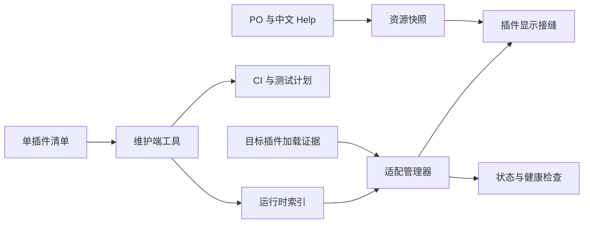

# 第三方插件中文适配系统设计

本文定义第三方适配的新契约。适配器以目标插件的正式接口、实际调用路径和验收结果为设计依据，内部接口、ID、状态模型和目录结构按本设计重新定义。文档中的命令和清单字段与当前实现对应。

## 用户体验与验收口径

用户沿用原插件的安装、配置、命令和按键。启用 `nvim-zh` 后，默认使用路径中由插件提供的固定文字从首次可接入的交互开始显示中文，覆盖菜单、窗口标题、输入与选择提示、通知、按键说明、健康检查及中文 Help。文件名、查询、调试值、配置标识、命令、快捷键和回调结果保留原值。显示与执行共用一个字段时，沿调用链寻找生成显示副本的入口。

以**用户任务**定义覆盖，例如 Telescope 的「首次打开文件搜索」「切换预览」「选择并打开文件」。清单为每个任务记录显示面、来源和验证用例。某个任务只有在所有纳入验收的固定显示面都有真实 Neovim TUI 的交互证据时才可标为已覆盖；受上游接口限制的显示面记录英文原文、原因和接入条件。测试同时检查中文宽度、截断、光标与高亮位置，以及原有操作是否仍然有效。

## 每个适配器独立维护

| 文件 | 职责 |
| --- | --- |
| `manifests/adapters/<id>.json` | 唯一手写登记。记录适配器 ID、目标插件仓库、跟踪策略、固定验证组合、适配入口、domain、显示面和场景 |
| `lua/nvim-zh/adapters/<id>.lua` | 需要定制的显示投影。可由公共接缝表达的适配直接使用声明，纯调查条目也可单独登记 |
| `translations/po/zh_CN/<domain>.po` | 插件拥有的静态文案与受控模板，包含 `msgctxt`、上游源码引用及必要的占位符说明 |
| `tests/contract/plugins/<id>/`、`tests/upstream/<id>/` | 离线行为契约和固定上游测试，按场景登记完整 TUI 用例 |
| `translations/help/adapters/<id>/` | 可选中文 Help 编辑源，按上游 tag、链接和示例块验收 |

ID 由清单显式定义，用于配置启停、诊断、测试选择和资源归属。每个显示面记录稳定 `surface_id`、上游字段或调用点、接缝类型、激活条件、PO context、正反用例及剩余范围。一个验证组合固定目标插件完整 commit、接缝依赖的源码和文档摘要、参与测试的依赖版本及 Neovim 版本。每个依赖通过 ID 引用统一的固定版本记录。构建器从同一份数据产生运行时索引、CI 取源和测试计划。

下面以 Telescope 的首开标题为例，节选单插件清单。`follow` 供维护端发现候选，`targets` 供发布验证，版本相关接缝通过 `modules` 声明所需的加载源码，各 `targets` 分别固定这些文件的摘要。

```json
{
  "schema": 1,
  "id": "telescope",
  "status": "implemented",
  "upstream": {
    "repository": "https://github.com/nvim-telescope/telescope.nvim",
    "follow": {
      "kind": "default_branch"
    }
  },
  "entry": "nvim-zh.adapters.telescope",
  "domain": "telescope",
  "modules": [
    "telescope",
    "telescope.pickers",
    "telescope.pickers.window",
    "telescope.previewers.previewer"
  ],
  "lazy_names": [
    "telescope.nvim"
  ],
  "targets": {
    "baseline": {
      "commit": "1e1bab730218eaf97fce743be3f56e51075928ac",
      "neovim": "0.12.6",
      "dependencies": [
        "plenary"
      ],
      "sources": {
        "lua/telescope/pickers.lua": "a9d66b553c399c175a5c2190c6f6aa035ebb80d048978bb5e9df02172198a6f6",
        "lua/telescope/pickers/window.lua": "61d0c06419de8ebee6755164a5d53ec01cefe0dc9ec65158e72a8b30b674f90b",
        "lua/telescope/actions/init.lua": "d7c9347c119b453832e2b27fb9a7bd6ef46ea79dc8a820a0160fa052f2e323b4"
      }
    }
  },
  "surfaces": {
    "initial_titles": {
      "kind": "versioned",
      "modules": {
        "telescope.pickers": "lua/telescope/pickers.lua",
        "telescope.pickers.window": "lua/telescope/pickers/window.lua",
        "telescope.actions": "lua/telescope/actions/init.lua"
      },
      "status_key": "window"
    }
  },
  "scenarios": {
    "find_files": {
      "surfaces": [
        "initial_titles"
      ],
      "tui": "tests/upstream/telescope/tui.py"
    }
  },
  "contracts": [
    "tests/upstream/telescope/telescope_first_picker_spec.lua"
  ]
}
```

运行时索引包含固定数据和明确的适配入口，随 Lua 实现冻结。构建器交叉校验提交、摘要、依赖、入口、用例引用和目录归属，拒绝孤儿文件和重复来源声明。`draft` 供维护工具检查，`inventory_only` 用于记录已确认的接缝空缺。两者均无挂载入口。插件启动只查询生成后的索引以及运行时提供的加载信息。

保留 Neovim 核心 gettext、Help 与资源快照作为独立能力。适配器注册、加载证据、接缝所有权和安装顺序由适配子系统负责。翻译目录只负责检索和发布译文。[资源同步架构](architecture.md)



## 接入策略

| 接缝 | 适用条件 | 例子 |
| --- | --- | --- |
| 上游本地化 API | 上游提供 locale、消息表或注册接口，且只改可见文字 | 注入翻译查询，保留上游自己的语言回退 |
| 公开显示入口 | 可用可验证的来源与稳定的入参识别插件自有字段 | 精确通知来源、公开 formatter、仅显示用途的标题或描述 |
| 有版本约束的显示投影 | 源码能证明行为字段与显示边界，且固定上游能重现完整用户场景 | Telescope 窗口标题；DAP UI 的高亮分段文字 |
| 仅调查 | 尚未找到能证明归属的显示入口 | `nvim-cmp` 当前缺少可安全翻译的插件自有固定标签 |

公共规则从通知、单字段格式化和事件触发这类重复模式起步。声明表达接缝种类、来源条件和目录查询参数。需要保存回调身份、识别结构化条目或调整渲染位置时，用小型 Lua 适配模块表达。共享入口同时验证来源和字段，并为每次调用选择一个归属。例如选择器识别候选结构后只处理 formatter 的显示结果，选择回调收到原始 item、索引和取消值。相同字符串或通知标题出现于多个来源时，必须有额外的归属证据才能启用投影。

运行时查询以 `domain + context + msgid` 为键。动态文本从原始字段组装受控模板，并保留占位值、命令 token 和控制符。宽度计算使用渲染所需的显示列，Lua/Neovim 高亮偏移仍按对应 API 的字节或列语义计算。未知来源、未知文本、模板歧义或接缝不适用时返回原始显示值；译文查询失败与上游函数自身的异常分别处理，上游异常按原路径传播。

**Telescope 示例。** 示例用 `User TelescopeFindPre` 在首开布局前协调接缝，从真实 `find_files` 打开 picker，在窗口布局投影中验证 `Find Files` / `Results` 显示为「查找文件」/「结果」，并断言 picker 内部标题、搜索排序和回调条目维持英文基线的语义。另用真实 refine 路径验证对 `Live Grep` 的内部判断。验收还包含与内置标题同字的自定义标题，验证适配器能够识别并保留其来源。若首开标题无法取得可靠来源或版本证据，该显示面继续使用上游文案。

## 生命周期和运行时版本证据

管理器只探测已加载模块。加载事件与有限补检协调待接入项；首次渲染前的事件可在同步边界内只协调其所属插件。在 `setup` 当场生成的显示面，以插件提供的更早接口或可配置的加载顺序为触发条件。接缝探测应验证来源、接口形状及 setup 就绪条件，等待中的字段可重试。

加载、启停、上游更新和资源提交进入同一协调过程。管理器根据清单、有效配置、活动快照与加载证据计算接缝的目标状态，再执行挂载或释放。相同输入的重复事件应无副作用。首次渲染前的同步事件复用同一过程，仅缩小到对应插件。清单解析与发布级证据检查在维护端完成，运行时热路径只保留必要的状态判断和目录查询。

**已安装版本与正在执行的版本各自有证据。** 安装目录、锁文件或安装管理器提供磁盘侧修订，供状态显示和更新调度。运行时证据绑定到实际加载的模块表、入口来源和当前代次，由上游公开 API 或有来源保证的加载集成提供。可接受的源码证据包括加载集成实际读取的模块字节摘要，或能证明模块从中加载的不可变安装快照及其已校验清单。运行中再去读取同路径的文件，只能说明磁盘现状。运行时解析证据时可以缓存当前模块代次的结果，高频渲染只检查代次和所有权。

| 接缝 | 激活所需证据 |
| --- | --- |
| 上游本地化 API、正式且稳定的显示 API | 证实正在调用所属插件的正式接缝，且满足其已审查的 API 契约和来源规则。精确 commit 未知时可报告 `api_contract`，只声明当前接缝可用 |
| 版本相关显示投影 | 已加载代码能对应通过验收的固定验证组合，且该接缝所依赖的运行时源码版本与来源完整，包括影响调用顺序或字段含义的相关模块。证据缺失、变更或混合版本时回退英文 |
| 中文 Help | 可验证当前安装的上游帮助文档与该译文绑定的文档摘要，按主题使用已验证版本 |

标准 `vim.pack` 加载按登记的仓库地址和实际模块路径识别源码。镜像及其他管理器可在插件加载前显式登记路径。加载集成保存实际执行的字节摘要和模块身份；一个组合涉及多个模块时逐一核对依赖。加载完成后在下一次调度协调挂载，首次渲染事件可同步协调。Telescope 和 which-key 的健康报告在各自固定源码模块的执行环境中投影，不竞争全局健康入口。固定版本证据缺失或上游更新时，各接缝按自身条件回退。默认启动不强制加载目标插件。

运行时为每个接缝保存挂载代次和恢复句柄。重复 setup 复用仍拥有的入口，同模块中被替换的入口进入 `external_override`。模块表换代时先让旧闭包透传，再对新代次重新探测。事件回调、异步完成和已流出的 wrapper 都检查代次和相关模块身份。挂载失败逆序释放本次取得的句柄，只恢复仍由自己持有的值；其余已提交且仍满足条件的接缝继续工作。关闭适配器后，自然创建或刷新时使用上游文案。

独立适配器入口提供挂载、释放和状态查询。内置适配器可以使用本地生命周期接缝；外置包采用逐显示面的只读探测与带所有权的挂载作用域。包装调用时保留全部参数和返回值，包括中间的 `nil`。

`status().adapters[id]` 和 `:checkhealth nvim-zh` 报告安装修订、可以证明的加载修订及接缝状态。每个接缝独立返回运行状态与验证方式。运行状态包括 `active`、`not_loaded`、`waiting_for_setup`、`unsupported_api`、`unknown_version`、`unsupported_revision`、`stale_generation`、`external_override`、`attach_failed` 和 `disabled`。验证方式为固定组合、正式 API 契约或缺证据，并给出匹配组合 ID。部分可用由接缝状态计算；目录命中统计和已验证场景分别展示。

### 第三方 Help 与外置适配包

第三方 Help 作为可选能力。每个插件的 `.cnx` 和预生成 `tags-cn` 在已验证快照内有独立的 Help 根。按安装侧证据选择对应文档版本，无需执行插件模块。上游文档更新、尚无匹配译文时，相关主题恢复从上游英文文档解析。关闭适配或 Help 时按所有权移除 Help 根。构建检查同一可见范围内的 tag 冲突，并验证 tag、命令和示例保持可用。

外置包从 Lua 配置调用 `register_adapter` 注册公开显示接缝。注册校验 ID、API 版本和目录，并提供可释放的所有权作用域。本地 JSON 可以按 ID 启停和覆盖译文，包加载由 Lua 配置或插件管理器负责。

```lua
local release = require('nvim-zh').register_adapter({
  api = 1,
  id = 'example',
  domain = 'example',
  catalog = {
    schema = 1, domain = 'example', locale = 'zh_CN',
    entries = { { context = 'title', msgid = 'Open', msgstr = '打开' } },
  },
  surfaces = {
    title = {
      module = 'example',
      probe = function(module)
        return type(module.display_title) == 'function' and module
      end,
      mount = function(scope, module)
        return scope.wrap(module, 'display_title', function(original)
          return function(...)
            return scope.translate('title', original(...))
          end
        end)
      end,
    },
  },
})
```

## 两条独立的更新路径

| 变化 | 当前 Neovim 会话 | 下一次加载 |
| --- | --- | --- |
| 上游插件更新或回退 | 安装管理器的已提交变更通知只使相关加载证据失效，并重新核对接缝；同一可变目录中新旧模块可能混用时，将相关版本接缝置为 `stale_generation`，旧闭包透传。已有界面在下一次自然渲染时体现变化 | 获得新代次的来源证据后，命中的固定组合重新接入，其他接缝各自按正式 API 或英文回退 |
| 只改翻译内容 | 校验适配契约、目录格式与文档基线后，原子替换资源快照；后续自然查询使用新译文 | 读取对应发布资源 |
| 改接缝、支持组合、适配清单或 SDK | 当前会话使用冻结的实现和与其契约匹配的资源。已失效的上游接缝继续透传，健康检查报告待启用版本 | 重启后成对启用新实现和资源，针对实际加载的上游版本重新选择接缝 |
| 更新取消、资源验证失败或挂载失败 | 取消保持原提交状态。资源校验失败保留活动快照；接缝失败仅撤销其本次安装，并在状态中记录原因 | 下一次更新或相关模块加载事件触发重新验证 |

每次发布由实现和资源清单标明适配契约标识。构建器从生成的运行时索引、适配器代码和共享适配 API 计算该标识；对应翻译与 Help 快照声明适用标识。目录与 Help 更新无需改变标识，前提是接入契约、支持组合和上游文档基线相同。候选校验成功后一次提交；旧代次收到迟到事件时按代次丢弃。上游插件与 `nvim-zh` 分别通过插件管理器更新或回退，本地化状态显示当前可用的组合和具体降级原因。

### 跟进上游的维护闭环

1. **发现候选。** 每个适配器声明跟踪稳定发行标签或默认分支。定时 CI 或维护者将该引用解析为完整 commit，连同实际要测的依赖与 Neovim 写入候选锁定文件。发布仍使用已固定的验证组合。候选从发现到验收始终使用同一份锁定输入。
2. **审计影响。** 对基线和候选比较装载时机、公开签名、显示数据来源、事件顺序、格式化占位符、Help tags 及依赖。报告把变化映射到 `surface_id`，标明源码位置和应运行的场景。审计覆盖与接缝相关的新文件和调用路径。文件改名、摘要变化或固定文案漂移只是审计线索，运行契约决定是否可用。
3. **更新适配。** 沿来源保留仍正确的 PO 条目。新词条、含义变化和占位符变化进入翻译审阅，过期条目从活动目录移出。接缝语义变化时同时更新归属判断、探测、显示投影和正反用例。某个接缝暂时无法恢复时，为该目标组合记录英文回退及原因，其余验收通过的接缝可发布。
4. **验证并发布。** 在干净的 Neovim 配置中固定并校验全部测试输入，再以真实 Neovim TUI 跑完场景。候选成为发布组合前必须通过完整 TUI 门禁。CI 保存绑定到适配发布修订和验证组合的证据。定时任务的候选退化会产生可审阅的差异，固定基线继续按独立任务运行。缺源码、摘要不符或环境故障记录为阻塞并返回失败。

每个插件默认先维护一个验证组合。有实际使用需求时，可在清单增加一个受支持组合，并由 CI 对各声明组合做相同验证。复用能够覆盖多个组合的接缝实现。接缝出现相互排斥的行为时，可按组合选独立投影；移除一个组合时同步删去未再引用的分支、译文和 Help，更新支持说明。精确修订的通过记录只适用于该验证组合，正式稳定 API 的可用性由其运行时契约单独判定。

## 完整 TUI 测试门禁

**每次引入或更新适配器，都要对受影响的适配器重跑全部已声明的 TUI 场景和受支持组合。** 触发范围包括接缝代码、清单、PO、中文 Help、目标上游及其固定依赖。共享运行时或测试环境变更时，由清单的依赖关系确定重跑范围；无法缩小范围时跑完整矩阵。审计识别受影响的场景用于调试，合入和发布依据该适配器的完整场景结果。

| 验收项 | 要求 |
| --- | --- |
| 真实终端链路 | 在隔离环境中将非 headless Neovim 连接到 PTY，使用固定 UTF-8 环境、终端类型和尺寸。通过 PTY 发送用户会输入的命令与按键，将终端输出解码为屏幕单元、光标及样式，以可见位置和内容作为断言。测试可以从进程读取结构化状态验证行为与所有权 |
| 完整操作路径 | 从干净会话启动，以用户命令或映射进入插件，检查首次显示、执行任务、后续刷新或重开及退出。清单中的标题、列表、输入、通知、Help 等显示面按实际适用的路径逐一验证。一条场景可以覆盖多个显示面，构建器检查每个启用的显示面都有 TUI 场景 |
| 开关差分与降级 | 固定同一组上游、依赖和测试数据，分别运行适配关闭与启用的操作。在屏幕上断言预期中英文、用户数据与按键导航，并验证操作副作用一致。适用时覆盖用户同名文本、未知版本、加载顺序、禁用后重新打开和更新后的回退 |
| 布局与更新后的恢复 | 对布局敏感场景验证普通与窄窗口，包含终端调尺寸后的中文显示列、截断、高亮、光标和选中项。更新场景在更新或回退完成后重新触发插件操作，从真实终端确认显示、降级原因和后续恢复情况 |

例如 Telescope 场景通过终端输入 `:Telescope find_files`，检查首个完整画面的边框标题，键入查询、移动选择并按 `<CR>` 打开固定测试文件，再分别验证适配禁用和重新打开时的输出。以终端屏幕满足预期为等待条件，设置超时并保留最近屏幕，避免固定延时造成假通过。现有仓库中的 PTY 进程和隔离环境可作为测试基础。[现有 PTY 测试](../tests/e2e/test_pack_tui.py)

CI 将 TUI 测试设为新增与更新的必过检查。报告按适配器、验证组合和场景记录 Neovim 版本、终端尺寸、运行结果和失败时的终端画面或输出。缺 PTY、缺任一必测场景、超时和可见结果不符都判定该门禁失败。离线契约和 headless 测试继续为生命周期和内部行为提供独立证据。发布验证组合只有完整 TUI 套件实际通过时才获得 TUI 通过记录。

## 维护工具

使用 `tools/adapter_tool.py` 查询、构建和验证适配器。`--json` 输出包含 schema、适配器 ID、基线和候选 commit、`surface_id`、场景 ID、文件与行号、诊断代码和用例结果。检查和测试的输入可以固定在本地，输出按输入确定性排序。`--source-root` 下按候选或基线锁定记录找到对应源码，以插件 ID 和 commit 隔离多个检出。发现与获取源码使用显式维护命令；测试阶段复用下载结果。

| 操作 | 命令 | 产物或判定 |
| --- | --- | --- |
| 查询 | `list --json`、`show <id> --json` | 所属文件、接缝、已验证场景和已知边界 |
| 新增 | `scaffold <id> --repo <url> --commit <sha>` | 清单、场景和必要文件的最小骨架。缺源码或缺验证时保留 `draft`，发布门禁检查实际挂载的接缝与证据 |
| 发现与获取 | `discover <id> --json`、`fetch --lock <file> --source-root <dir>` | 将跟踪引用解析为上游验证候选，按锁定的提交获取各项源码。基线锁定输入可从清单生成 |
| 修改或跟进上游 | `audit <id> --candidate <lock> --source-root <dir> --json` | 比较候选与固定基线，定位断开的引用、受影响的接缝、文案变化和待补场景。输出可保存为独立文件的 `candidate_lock`。候选测试在临时工作副本生成索引和资源；审核后更新正式清单、PO、Lua 和测试 |
| 检查 | `check <id> --json` | schema、文件归属、PO 引用及占位符、生成索引、各显示面的 TUI 场景登记、通知与 Help 归属的机读诊断 |
| 测试 | `test <id> --offline`、`test <id> --upstream --target <name> --source-root <dir>` | 真实上游入口执行该组合全部 TUI 场景与其他上游契约，可用 `--candidate <lock>` 选择候选组合。缺源、摘要不符或 TUI 门禁未通过时失败 |
| 移除 | `remove <id> --plan`、`remove <id>` | 输出或应用按清单归属计算的变更，随后运行 `make build-resources` 清理派生资源。共享依赖保留至最后一个引用消失 |

维护时从单插件清单和固定源码核对用户操作与文案来源，更新离线契约、TUI 场景、PO 与接缝后运行检查。验证记录注明改动的显示面、操作行为、实际命令和验证组合。
